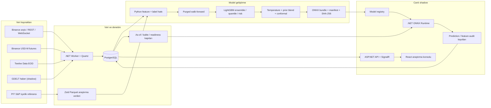
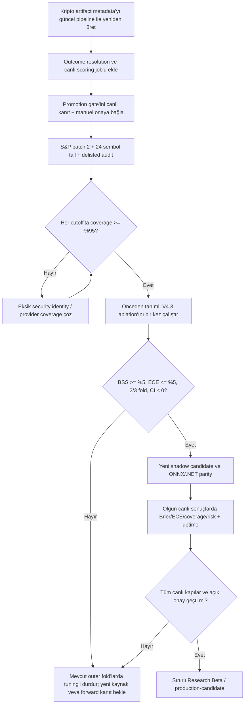

# Probora Teknik Durum ve Model Araştırma Brifingi

**Durum tarihi:** 20 Temmuz 2026
**Amaç:** Probora'da bugüne kadar kurulan veri, model, doğrulama, canlı shadow ve ürün altyapısını teknik ayrıntılarıyla tek belgede toplamak; bundan sonraki model araştırmalarında ortak ve denetlenebilir bir başlangıç noktası sağlamak.

> Bu belge bir yatırım stratejisi veya yatırım tavsiyesi değildir. Probora şu anda üretime açılmış bir al-sat sistemi değil, canlı veri üzerinde kanıt toplayan bir araştırma platformudur.

## 1. Kısa ve dürüst sonuç

Probora'nın güçlü tarafı şu anda “piyasayı yenmiş model” değil; zaman sızıntısını önlemeye çalışan veri hattı, tekrar üretilebilir deneyler, ayrı yön/senaryo kapıları, ONNX tabanlı canlı inference, shadow kayıtları ve başarısız deneyleri de saklayan model yönetişimidir.

Bugünkü teknik gerçek şudur:

- Dört güncel model ailesi vardır: kripto 30 gün, kripto 90 gün, ABD hisseleri 30 seans ve ABD hisseleri 90 seans.
- Hiçbiri production model değildir; hepsi shadow/research durumundadır.
- ABD modellerinin **yön** çıktısı güçlü baseline'ı geçemediği için kapalıdır. Buna karşılık P10-P90 senaryo aralıkları tarihsel testlerde kullanılabilir kalite kapısını geçmiştir.
- Kripto yön modellerinin düzeltilmiş, validation-only baseline değerlendirmesinde küçük veya negatif skill'i vardır; hedeflenen `+%5 Brier Skill Score` seviyesinde değildir.
- Henüz olgunlaşmış canlı shadow etiketi yoktur. Dolayısıyla gerçek forward Brier skoru henüz hesaplanamaz.
- S&P 500 point-in-time breadth çalışmasının ilk 367 sembollük partisi tamamlandı; fakat tarihsel günlük kapsama yaklaşık `%44,1` ortalama ve `%38,4` minimum düzeyindedir. Zorunlu `%95` kapısı kapalıdır, bu nedenle eksik veri V4.3 eğitimine giremez.
- En önemli mevcut yönetişim borcu, eski kripto artifact manifestlerindeki `directionEligible=true` bilgisinin güncel baseline kurallarıyla çelişmesidir. Bu artifact'lar production değildir ama yeni pipeline ile yeniden üretilip metadata düzeltilmelidir.

Başka bir ifadeyle: altyapı umut vericidir, fakat yön tahmininde kanıtlanmış edge henüz yoktur. Sistem bu gerçeği gizlemek yerine sinyali bastıracak şekilde tasarlanmıştır.

## 2. Ürün sözleşmesi

Probora'nın tahmin problemi tek bir “fiyat kaç olacak?” sorusu değildir. Her varlık ve ufuk için üç ayrı çıktı üretilir:

1. **Yön dağılımı:** düşüş, yatay ve yükseliş olasılıkları.
2. **Getiri senaryosu:** ileri log getirinin P10, P50 ve P90 quantile tahminleri.
3. **Risk:** ileri dönemin gerçekleşen volatilitesinden türetilen `0-1` arası risk skoru.

Kriptoda ufuklar 30 ve 90 **takvim günü**, ABD hisselerinde 30 ve 90 **işlem seansı**dır. Bu iki saat ölçeği aynı şey değildir ve değerlendirme sırasında ayrı tutulur.

Sistem otomatik işlem açmaz. Modelin yön kapısı kapalıysa arayüz olasılıkları kullanıcı sinyaline dönüştürmez. Senaryo kapısı açık olsa bile gösterilen aralık “kesin hedef fiyat” değil, kalibre edilmiş olasılıksal bir getiri aralığıdır.

## 3. Uçtan uca mimari



### Teknoloji yığını

| Katman | Teknoloji | Sorumluluk |
|---|---|---|
| Backend | .NET 10, ASP.NET Minimal API, EF Core/Npgsql | API, veri modeli, sorgular, güven ve kalite kapıları |
| Worker | .NET Worker, Quartz persistent scheduler | Veri toplama, retry, model registry, günlük shadow inference |
| Canlı model | ONNX Runtime 1.27 | Python'da eğitilen LightGBM artifact'larını .NET'te çalıştırma |
| Model araştırması | Python 3.12/3.13, LightGBM 4.6, scikit-learn, pandas, NumPy | Feature, label, split, kalibrasyon, ablation ve export |
| Veri | PostgreSQL 17, Zstd Parquet, DVC/MinIO/MLflow desteği | Operasyonel kayıt, araştırma datasetleri, artifact/deney izleme |
| Web | React 19, TypeScript 6, Vite 8, Recharts, SignalR | Model, veri sağlığı, shadow ve araştırma dashboard'ları |
| Operasyon | Docker Compose, Caddy, OpenTelemetry | Yerel/VPS dağıtım, gateway, log/telemetri |
| CI | GitHub Actions | .NET/Python/web testleri, audit ve container build |

Çözüm katmanları `Domain`, `Contracts`, `Application`, `Infrastructure`, `ML.Runtime`, `Api`, `Worker` ve test projeleri olarak ayrılmıştır. Bu ayrım model araştırması ile canlı servis kodunun birbirine kontrolsüz biçimde karışmasını azaltır.

## 4. Varlık evreni

### Kripto

Sekiz Binance USDT çifti kullanılır:

`BTCUSDT`, `ETHUSDT`, `SOLUSDT`, `BNBUSDT`, `XRPUSDT`, `ADAUSDT`, `LINKUSDT`, `DOGEUSDT`.

### ABD pilot evreni

Yirmi yüksek likiditeli hisse/ETF shadow olarak izlenir:

- Endeks ve sektör ETF'leri: `SPY`, `QQQ`, `IWM`, `DIA`, `XLK`, `XLF`, `XLE`, `XLV`.
- Hisseler: `AAPL`, `MSFT`, `NVDA`, `AMZN`, `GOOGL`, `META`, `TSLA`, `JPM`, `V`, `XOM`, `UNH`, `WMT`.

Bu liste production evreni olduğu için değil, ilk ABD veri ve inference sözleşmesini sınamak için sabitlenmiş bir pilot olduğu için küçüktür. V4 araştırması survivorship bias üretmeden daha geniş bir point-in-time S&P 500 evrenine geçmektedir.

## 5. Veri kaynakları ve veri sözleşmeleri

### 5.1 Kripto spot

- Tarihsel saatlik mumlar Binance Public Data aylık ZIP arşivlerinden alınır.
- Arşiv checksum'ı doğrulanmadan dosya işlenmez.
- Güncel REST senkronizasyonu son mumlarla mutabakat yapar; worker bunu on dakikada bir çalıştırır.
- WebSocket yalnızca kapanmış saatlik mumları incremental olarak yazar.
- Saatlik mumlar UTC günlük OHLCV'ye toplanır.
- 2025 sonrası Binance zaman damgalarındaki mikrosaniye formatı ayrıca ele alınır.

Fiyat, OHLC tutarlılığı, hacim ve işlem sayısı kontrolleri vardır. `(asset, open_time, interval, source)` benzersizdir; retry aynı veriyi ikinci kez çoğaltmaz.

### 5.2 Kripto türevleri

V2/V3 challenger veri grubu Binance USD-M kaynaklarını kullanır:

| Kaynak | Üretilen bilgi |
|---|---|
| Perpetual funding | 7/30 günlük ortalama, 90 günlük z-skor |
| Premium/basis | 7/30 günlük ortalama, 90 günlük z-skor |
| Futures OHLCV | 30 günlük hacim z-skoru, 7 günlük taker-buy oranı |
| Open interest | 7/30 günlük log değişim, 90 günlük z-skor |
| Long/short ve taker oranları | 7 günlük ortalamalar |

Tarihsel arşiv ile canlı collector farklı görevlerdir. Canlı collector için:

- Kesim `D 00:00 UTC`, veri penceresi `[D-1 00:00, D 00:00)` biçimindedir.
- İlk deneme `00:05 UTC`, son pencere `00:50 UTC` civarındadır; beş dakikalık retry uygulanır.
- Futures/premium için 24 tamamlanmış saat, OI ve oranlar için 288 adet beş dakikalık kova beklenir.
- İstekler açık `startTime` ve `endTime=D 00:00-1 ms` kullanır.
- `source_max_event_time >= cutoff` veya `available_at > inference_time` ise as-of ihlali sayılır.
- Tahmin için 90 kesintisiz, tam günlük türev snapshot gerekir.
- Tam olmayan gün sıfırla doldurulmaz; tahmin ertelenir ve kalite olayı açılır.

Bu kalıcılık önemlidir: Binance bazı OI/oran uçlarında yalnızca yaklaşık son 30-31 günü verir. Bugün saklanmayan geçmişin daha sonra kusursuz biçimde yeniden kurulacağı varsayılmaz.

### 5.3 ABD EOD

ABD pilot verisi Twelve Data'dan `adjust=all` sözleşmesiyle alınır; bu seçim split/dividend uyumunu hedefler. Yalnızca tamamlanmış işlem seansları kabul edilir. Hafta sonları ve resmi tatiller veri kaybı sayılmaz.

Collector `05:15`, `07:15`, `09:15 UTC` pencerelerinde çalışır. Tahmin job'u veri toplandıktan sonra `05:45`, `07:45`, `09:45 UTC` pencerelerinde tekrar denenir. Aynı seans ikinci kez yazılmaz; retry operasyonel iyileşme sağlar, yeni bağımsız gözlem üretmez.

### 5.4 Haber ve makro veriler

GDELT haber hattı yalnızca shadow araştırmasıdır; aktif model feature şemasına dahil değildir. API'de görülen `429 Too Many Requests` olayları nedeniyle rate-limit/backoff ayrıca ele alınmalıdır. Tam haber metni saklanmaz; başlık, URL, kaynak, zaman, eşleşme ve türetilmiş skor sözleşmesi hedeflenir.

FRED araştırmasında `VIXCLS`, `DGS2`, `DGS10` ve `NFCI` denenmiştir. Yedi takvim günlük konservatif gecikmeyle backward as-of join yapılmıştır. Fakat indirilen seri current-vintage olduğu için ALFRED vintage veya değişmez canlı snapshot olmadan production gerçeği sayılmamıştır.

FNSPID gibi çok büyük fiyat/haber datasetleri lisans bakımından da filtrelenmiştir. CC BY-NC benzeri ticari kullanımı sınırlayan kaynaklar, yüksek satır sayısına rağmen production veri sözleşmesine alınmamıştır.

### 5.5 Point-in-time S&P 500 breadth

Mevcut 20 hisselik pilot, geniş piyasa breadth'i için yetersiz ve gürültülüdür. Bunun için:

- 2013 sonrası 734 benzersiz tarihsel sembol içeren MIT lisanslı üyelik snapshot'ı donduruldu.
- Güncel değişiklikler yalnızca efektif tarihlerinden sonra uygulanarak evren 758 tarihsel sembole genişletildi.
- Ana 734 çağrı alfabetik ve deterministik olarak `367 + 367` iki partiye ayrıldı.
- Her sembol ayrı Zstd Parquet dosyasına yazılır; state JSON her sembolden sonra atomik güncellenir.
- Başarılı ve bilinen başarısız semboller normal restart'ta tekrar çağrılmaz.
- Delisted çözümleme yalnızca açık `--retry-failed --resolve-delisted` auditiyle yapılır.
- Her tarihsel cutoff'ta üyelerin en az `%95`i fiyatla eşleşmeden dataset oluşturulmaz.
- Üyelik kaynağı 35 günden eskiyse gate kapanır.

20 Temmuz 2026 durumunda ilk 367 sembol işlenmiştir: 297 başarılı, 70 başarısız ve 1.020.675 günlük bar. Ortalama günlük kapsam `%44,11`, minimum `%38,36`, son dönem `%48,71`dir. Bu nedenle `coverageReady=false` olması beklenen ve doğru davranıştır.

“2,5 milyon günlük bar”, 2,5 milyon takvim günü demek değildir. Yaklaşık 734 menkul kıymet × 3.405 işlem seansı, yaklaşık 2,5 milyon **sembol-seans satırı** demektir.

## 6. Zaman güvenliği: leakage nasıl engelleniyor?

Finansal tahminde en tehlikeli hata modelden çok zamandır. Probora iki zaman kavramını ayırır:

- `event/open/snapshot time`: piyasa olayının ait olduğu zaman.
- `available_at`: bu bilginin model tarafından gerçekten görülebileceği en erken zaman.

Bir feature yalnızca tahmin anında erişilebilir satırlardan üretilebilir. Eğitim örneği ayrıca `[snapshot_time, label_end_time]` olay aralığını taşır.

### Purging ve embargo

Random train/test split kullanılmaz. Dış test yılları 2023, 2024 ve 2025'tir. Her fold için bir önceki yıl validation olarak kullanılır:

```text
test = 2023 ise validation = 2022, train = daha eski dönem
test = 2024 ise validation = 2023, train = daha eski dönem
test = 2025 ise validation = 2024, train = daha eski dönem
```

Kodun uyguladığı temel koşullar:

```text
train.label_end_time < validation_start - 7 gün
validation.snapshot_time >= validation_start
validation.label_end_time < test_start - 7 gün
test.snapshot_time test yılı içinde
```

Böylece 30/90 günlük bir label validation veya test sınırının içine taşıyorsa ilgili örnek purge edilir. Sınırlardan önce ek yedi günlük embargo vardır. Aynı tarihteki tüm varlıklar timestamp tabanlı maskeyle aynı fold'da kalır; bir hissenin aynı günkü verisi train'de, diğerinin testte bulunmaz.

Bu tasarım leakage'i önemli ölçüde azaltır, fakat örnek sayısının bağımsız olduğu anlamına gelmez. Özellikle 90 seanslık etiketler ağır biçimde örtüşür. Yaklaşık 12,4 yıllık ABD tarihinde yüz binlerce varlık satırı bulunmasına rağmen kabaca yalnızca 35 bağımsız, örtüşmeyen 90-seanslık makro pencere vardır.

## 7. Etiket tasarımı

Sınıflar `0=düşüş`, `1=yatay`, `2=yükseliş`tir. İleri getiri basit yüzde değil log getiridir:

```text
r_h = log(close[t+h] / close[t])
```

Yatay bant sabit `%5` değildir. Kısa ve uzun dönem yıllıklandırılmış volatilite birleştirilir:

```text
sigma_blend = sqrt(0.65 × sigma_short² + 0.35 × sigma_long²)
sigma_robust = clip(sigma_blend, 0.20, 1.50)
raw_threshold = 0.5 × sigma_robust × sqrt(horizon / periods_per_year)
threshold = clip(
    raw_threshold,
    0.025 × sqrt(horizon / 30),
    0.18  × sqrt(horizon / 30)
)
```

Son karar:

```text
r_h > +threshold  => yükseliş
r_h < -threshold  => düşüş
aksi              => yatay
```

Kriptoda `sigma_short=30 gün`, `sigma_long=90 gün`, `periods_per_year=365`; hisselerde `20/60 seans` volatilitesi ve `periods_per_year=252` kullanılır. Bu yapı her varlığın içsel oynaklığına uyum sağlar ve aynı sabit yüzdeyi BTC ile düşük volatiliteli bir ETF'ye zorla uygulamaz.

Mevcut dataset sınıf dağılımları:

| Dataset | Ufuk | Satır | Düşüş | Yatay | Yükseliş |
|---|---:|---:|---:|---:|---:|
| Kripto V3 | 30 gün | 19.890 | %29,04 | %40,42 | %30,53 |
| Kripto V3 | 90 gün | 19.410 | %30,19 | %36,72 | %33,09 |
| ABD V1 | 30 seans | 62.400 | %18,01 | %43,76 | %38,22 |
| ABD V1 | 90 seans | 61.200 | %13,40 | %41,21 | %45,39 |

ABD 90 seans etiketinde düşüş sınıfının yalnızca `%13,4` olması önemli bir araştırma problemidir. Accuracy bu dengesizlik altında tek başına güvenilir ölçü değildir.

ATR ile bandı büyütme deneyi yapılmıştır. `0.65` çarpanlı ATR-confirmed sürüm düşüş sınıfını yaklaşık `%5,5`e indirip yalnızca bir fold kazandığı için reddedilmiştir. GARCH/realized-vol alternatifleri ancak ayrı, önceden tanımlı label ablation olarak denenmelidir.

## 8. Feature şemaları

### 8.1 Kripto `crypto-daily-v2`: 42 feature

**28 spot feature** şu gruplardan oluşur:

- Log momentum/getiri: 1, 3, 7, 14, 30, 60, 90 gün.
- Yıllıklandırılmış volatilite: 7, 30, 90 gün.
- Teknik yapı: RSI-14, normalize MACD, normalize ATR-14, Bollinger width.
- Trend: fiyat/MA oranları 7, 30, 90, 200 gün ve 30 günlük MA eğimi.
- Likidite/akış: 30 günlük hacim ve trade-count z-skoru, 7 günlük taker-buy oranı.
- Piyasa ilişkisi: BTC korelasyonu 30/90, BTC beta 30, BTC'ye göre relative strength.
- Cross-asset görünüm: sekiz kriptoda 30 günlük pozitif getiri breadth'i.
- Deterministik rejim: 90 günlük trend ile 30 günlük volatiliteden `-2..+2` kodu.

**14 türev feature** funding, premium, futures hacmi/taker akışı, OI ve long-short oranlarından gelir. `derivatives_available` flag'i canlı inference için ayrıca gate görevi görür.

Momentum rank, volatilite rank ve asset one-hot feature'ları challenger datasetinde tutulmuş; risk MAE'yi bozdukları için canlı V2 şemasına alınmamıştır.

### 8.2 ABD `us-equity-daily-v1`: 33 feature

- Getiri: 1, 3, 5, 10, 20, 60, 120 seans.
- Volatilite: 5, 20, 60 seans ve 20 seans downside volatility.
- Teknik/trend: RSI, MACD, ATR, Bollinger width, MA 5/20/60/200 oranları ve eğim.
- Likidite: volume ve dollar-volume z-skoru.
- Seans mikro yapısı: overnight gap ve intraday return.
- SPY ilişkisi: 20/60 korelasyon, 20 beta ve 20 seans relative strength.
- Kesitsel bilgi: 20 seans breadth, 20/60 momentum rank ve 20 volatilite rank.
- Deterministik varlık rejimi.

SPY'nin 20/60 getiri-volatilite ve trend/rejim feature'larını açıkça ekleyen V3 deneyi 30 seansta üç fold'un tamamında kötüleşmiş; 90 seansta ortalama çok küçük iyileşme gösterse de üç fold'un ikisini kaybetmiştir. Bu nedenle canlı schema değişmemiştir.

### 8.3 V4 araştırma feature'ları

Canlı şemaya alınmadan izole ablation olarak hazırlanmıştır:

- Nominal getiri yerine hisse eksi SPY ve altcoin eksi BTC market-relative hedefleri.
- Geniş breadth, hareketli ortalama üstü oranı ve cross-sectional dispersion.
- Causal peer ETF'ye göre momentum/volatilite.
- Dokuz sektör ETF'sinde breadth, dispersion ve cyclical-defensive spread.
- Point-in-time S&P 500 için 1/5/20/60 seans pozitif getiri breadth'i, 20/60 MA üstü oranı, 20/60 dispersion ve median return: toplam on feature.

## 9. Model ailesi

### 9.1 Yön modeli

Ana model üç sınıflı LightGBM'dir. Sabit kapasite ayarları:

```text
objective=multiclass, num_class=3
n_estimators=400, learning_rate=0.025
num_leaves=15, max_depth=6
min_child_samples=40
subsample=0.8, colsample_bytree=0.8
reg_alpha=0.2, reg_lambda=1.0
```

Beş seed (`17, 29, 43, 71, 101`) ayrı eğitilir ve olasılıkları ortalanır. Bu, tek seed varyansını azaltır; beş farklı veri rejimi veya beş bağımsız model ailesi demek değildir.

RTX 3050 Ti, LightGBM'in OpenCL `device_type=gpu` yoluyla kullanılır. Başlangıçta küçük bir gerçek fit yapılarak GPU desteği doğrulanır; GPU istenmiş ama LightGBM kullanamıyorsa sessizce CPU'ya düşmek yerine hata verilir. Buradaki yol PyTorch CUDA kernel'i değil LightGBM GPU/OpenCL yoludur.

### 9.2 Olasılık kalibrasyonu

Her dış fold'da kalibrasyon yalnızca chronological validation üzerinde fit edilir:

1. Beş modelin validation olasılığı ortalanır.
2. `T ∈ [0.25, 10]` log-grid üzerinde NLL'yi düşüren temperature seçilir.
3. Temperature-scaled tahmin ile train class-prior arasında Brier-optimal konveks blend ağırlığı seçilir.
4. Seçilen temperature ve blend, dokunulmamış dış teste uygulanır.

Canlı form kabaca şöyledir:

```text
p_calibrated = softmax(log(p_ensemble) / T)
p_final = w × p_calibrated + (1-w) × p_train_prior
```

Model zayıfsa `w` sıfıra yaklaşır ve güvenli climatology fallback'e döner. Bu nedenle arayüzde üç olasılığın birbirine yakın görünmesi hata olmak zorunda değildir; modelin prior'a küçültüldüğünü veya ayrıştırıcı sinyalin zayıf olduğunu gösterebilir.

Log-probability matrix/Dirichlet-form kalibrasyon denenmiş, bazı validation dönemlerinde seçilse de outer testte istikrarlı kazanç göstermediği için reddedilmiştir. Bu implementasyon ODIR/SMS iddiası taşımaz.

### 9.3 Getiri quantile modelleri

P10, P50 ve P90 için üç ayrı LightGBM quantile regressor eğitilir. Tahminde quantile crossing oluşursa üç değer sıralanır. Raw P10-P90 aralığı daha sonra validation'da öğrenilen volatility-scaled conformal genişletmeyle düzeltilir:

```text
scale = point_in_time_annualized_volatility × sqrt(horizon / periods_per_year)
adjustment = conformal_multiplier × scale
P10_final = P10_raw - adjustment
P90_final = P90_raw + adjustment
```

Absolute conformal adjustment, 2022 yüksek volatilite hatasını 2023 sakin rejimine taşıyıp `%95` gibi gereksiz yüksek coverage ve çok geniş aralık üretmişti. Volatilite ölçekli yöntem 90 seans ortalama coverage'ı `%82,64`te tutarken interval score'u `0.55773`ten `0.52029`a düşürdü ve üç fold'un üçünü kazandı.

### 9.4 Risk modeli

Hedef, ileri pencerenin yıllıklandırılmış gerçekleşen volatilitesidir. Modelin `0-1` hedefi:

```text
risk_target = 1 - exp(-future_annualized_volatility)
```

LightGBM regression çıktısı `[0,1]` aralığına kırpılır. Baseline, bugünkü kısa dönem volatilitesine aynı dönüşümü uygular. Risk modeli yön modelinden bağımsız metrikle değerlendirilir.

## 10. Baseline ve metrikler

### Brier skoru

Üç sınıflı Brier skoru:

```text
Brier = mean(sum_k((p_k - y_k)²))
```

Mükemmel tahmin `0`, üç sınıfa eşit `1/3` veren tahmin yaklaşık `0.6667` alır. Bu nedenle `0.65` civarı skor ilk bakışta düşük görünebilir ama asıl soru mutlak sayı değil, aynı fold'da seçilmiş güçlü baseline'dan iyi olup olmadığıdır.

```text
BSS = 1 - Brier_model / Brier_baseline
```

`BSS > 0` baseline'dan iyi, `BSS < 0` kötüdür. Production hedefi yalnızca pozitif olmak değil, en az `+%5` BSS'tir.

### Stabil baseline seçimi

İki gerçek baseline ve bir sanity check vardır:

- Train sınıf frekansını sürekli veren sıfır parametreli climatology.
- Balanced multinomial logistic regression.
- Uniform `1/3,1/3,1/3` tahmin sanity check'i.

Logistic baseline yalnızca **validation** döneminde hem climatology'yi hem uniform tahmini en az `0.005` Brier geçerse seçilir. Aksi halde climatology sabitlenir. Testte hangisinin iyi çıktığına bakıp baseline değiştirilmez. Önceki test-oracle minimumu yalnızca tanı metriği olarak tutulur.

### Diğer metrikler

- ECE ve classwise ECE: olasılık kalibrasyonu.
- Murphy decomposition: reliability, resolution, uncertainty ve binning gap.
- Accuracy: yalnızca destekleyici; class imbalance nedeniyle ana promotion metriği değildir.
- Pinball loss: P10/P50/P90 doğruluğu.
- Interval score: hem aralık genişliğini hem dışarı kaçan gerçekleşmeleri cezalandıran proper score.
- Coverage: P10-P90 içine düşen gerçekleşme oranı; hedef `%75-%85`.
- Risk MAE: risk modelinin hata büyüklüğü.
- Paired block bootstrap: günlük kayıp farklarını ufuk uzunluğunda bloklarla yeniden örnekleyerek `%95` güven aralığı.

Boosted tree için klasik AIC/BIC parametre sayısı iyi tanımlı değildir. Bu nedenle information-criterion benzeri ceza yalnızca inner selection'da ilave serbest parametre/feature karmaşıklığını konservatif biçimde cezalandırır; tek başına promotion kararı vermez.

## 11. Promotion kapıları

### Yön kapısı

- Ortalama Brier, stabil baseline'dan en az `%5` iyi.
- Üç dış fold'un en az ikisinde baseline kazanılır.
- ECE en fazla `%5`.

### Senaryo kapısı

- Ortalama quantile pinball baseline'dan en az `%2` iyi ve en az 2/3 fold kazanır.
- Interval score baseline'dan en az `%2` iyi ve en az 2/3 fold kazanır.
- P10-P90 coverage `%75-%85` aralığındadır.
- Risk MAE baseline'dan en az `%5` iyi ve en az 2/3 fold kazanır.

Yön ve senaryo kapıları bağımsızdır. Bir model yön tahmini yayımlayamasa bile doğrulanmış getiri/risk senaryosu gösterebilir.

### Canlı güven kapısı

Model tarihsel kapıyı geçmiş olsa dahi tek tahmin için ayrıca:

- en yüksek olasılık `>= 0.55`,
- en yüksek ile ikinci olasılık farkı `>= 0.15`,
- P50 getiri yönü ile baskın sınıf çelişmemeli,
- veri taze ve feature seti tam olmalıdır.

Güven skoru şu bileşenleri kullanır:

```text
score = clip(
    0.65 × top_probability
  + 0.35 × probability_margin
  - direction_conflict_penalty
  - interval_width_penalty,
  0, 1
)
```

Direction gate kapalıysa sonuç `ResearchOnly/InsufficientConfidence` olur ve skor en fazla `0.49` olarak tutulur.

## 12. Bugünkü model sonuçları

### Registry'deki güncel shadow artifact'ları

| Model | Brier | Baseline | Yaklaşık BSS | ECE | P10-P90 coverage | Manifest yön | Manifest senaryo |
|---|---:|---:|---:|---:|---:|---|---|
| Kripto 30 gün | 0.65975 | 0.65652 | -%0,49 | %5,30 | %86,20 | Açık* | Açık* |
| Kripto 90 gün | 0.64995 | 0.64570 | -%0,66 | %5,33 | %79,84 | Açık* | Açık* |
| ABD 30 seans | 0.63207 | 0.62176 | -%1,66 | %3,04 | %83,69 | Kapalı | Açık |
| ABD 90 seans | 0.61599 | 0.58787 | -%4,78 | %7,56 | %82,68 | Kapalı | Açık |

`*` Kripto satırlarındaki açık işareti güncel bilimsel karar değildir; 14 Temmuz tarihli eski artifact manifest bilgisidir. Stabil, validation-only baseline düzeltmesinden sonra yapılan temiz RTX 3050 Ti koşusunda kripto 30 gün BSS yaklaşık `+%0,06`, kripto 90 gün `+%1,30` bulunmuş; ikisi de `%5` yön kapısını ve senaryo kapısını geçememiştir. Yeni artifact üretilmeden eski manifest ile güncel araştırma sonucu aynı kabul edilmemelidir.

Hiçbir satır production değildir. ABD 30/90 senaryo kontratları tarihsel quantile/interval/risk kapılarını geçtiği için shadow arayüzünde yönsüz senaryo olarak değerlendirilebilir.

### Rejim teşhisi

V2 hata analizi takvim yılına ek olarak şu segmentlerde yapılır:

- düşük/normal/yüksek volatilite,
- düşük/normal/yüksek hacim,
- mean-reverting/transition/trend,
- bull trend/bear trend/mean-reverting/transition.

Mevcut ABD yön modelinin ana sorunu yüksek volatilitede ve özellikle 90 seans ufkunda düşük resolution'dır. Kripto için regime-conditioned prior blend denenmiş; inner validation'daki en iyi ham kazanç karmaşıklık cezasından küçük kalmış ve selector tüm fold'larda global blend'i korumuştur. Bu yüzden post-hoc rejim gate'i canlıya alınmamıştır.

## 13. Yapılan V3/V4 deneylerinin özeti

| Deney | Sonuç | Karar |
|---|---|---|
| Matrix/Dirichlet-form calibration | Dış testte istikrarlı değil | Reddedildi |
| Açık SPY macro feature grubu | 30 seansta 3/3 kötü; 90'da çok küçük/istikrarsız | Reddedildi |
| ATR-confirmed label | Sınıf dengesini bozdu, 1/3 fold | Reddedildi |
| Sığ/recent-window LightGBM | Stabil pozitif BSS yok | Reddedildi |
| FRED stress feature'ları | Çok küçük kazanç, negatif locked-2026; vintage sorunu | Research-only |
| Volatility-scaled conformal | Coverage ve interval score dengesi 3/3 iyileşti | Kabul edildi |
| Kripto regime blend | Karmaşıklık cezasını aşmadı | Reddedildi |
| Altcoin eksi BTC hedefi | BSS -%1,37; CI sıfırı kesiyor | Reddedildi |
| Hisse eksi SPY nominal hedefi | BSS +%2,55; 3/3; CI tamamen iyi yönde | Araştırmaya devam |
| SPY-relative ordinal | BSS +%2,72; nominalden fark CI'ı sıfırı kesiyor | Henüz deploy edilmedi |
| Cross-sectional/peer V4.1 | En iyi BSS +%2,79; istikrarsız | Reddedildi |
| Dokuz sektör V4.2 | En iyi BSS +%2,83; CI sıfırı kesiyor, ECE kötü | Reddedildi |
| PIT S&P breadth V4.3 | Kod ve feature grubu önceden tanımlı | Veri gate'i bekleniyor |

Hisse eksi SPY hedefi şu ana kadarki en anlamlı yeni yön bulgusudur. Residual volatilite:

```text
sigma_residual = sqrt(
    sigma_asset² + sigma_benchmark²
  - 2 × correlation × sigma_asset × sigma_benchmark
)
```

ile hesaplanır ve dinamik neutral band buna göre kurulur. SPY'nin kendisi relative datasetten çıkarılır. Tarihsel 3/3 fold kazanımı ve tamamen sıfırın altında Brier-delta güven aralığı olumlu; ancak `+%5` BSS ve `%5` ECE kapıları hâlâ geçilmemiştir. Aynı 2023-2026 döneminde tekrar tekrar ayar aramak bağımsız kanıt üretmez.

## 14. Artifact, registry ve .NET inference

Her model bundle'ında şu dosyalar bulunur:

- Beş yön ONNX modeli.
- `return-p10.onnx`, `return-p50.onnx`, `return-p90.onnx`.
- `risk.onnx`.
- Sıralı feature şeması.
- Dataset/model versiyonu, calibration değerleri, prior, güven eşikleri ve uygunluk flag'lerini içeren manifest.
- Fold metriklerini içeren JSON.

ONNX dosyalarının adları ve byte içerikleri SHA-256 ile hash'lenir. Worker registry'ye almadan önce sabit-zaman hash karşılaştırması yapar. Export sonrasında her ONNX dosyası CPU provider ile smoke-load edilir.

.NET runtime:

1. Feature sırasını schema'dan okur.
2. Beş yön modelini çalıştırıp ortalar.
3. Temperature scaling ve class-prior blend uygular.
4. Üç quantile'ı çalıştırır, sıralar ve conformal genişletir.
5. Risk modelini çalıştırıp `[0,1]`e kırpar.
6. Feature snapshot ve prediction kaydını artifact hash'iyle birlikte yazar.

Python feature formülleri ile .NET canlı feature builder'larının eş olması zorunludur. Production adayı öncesi Python/ONNX/.NET parity testi gate olarak ele alınmalıdır.

## 15. Açıklanabilirlik

Canlı açıklama SHAP değildir. Her feature tek tek eğitim medyanına çekilir, ONNX inference yeniden çalıştırılır ve:

```text
impact = original(P_up - P_down) - perturbed(P_up - P_down)
```

hesaplanır. En büyük üç pozitif ve üç negatif fark kullanıcıya “olasılık puanı” olarak verilir. Referanslar manifestte saklanan eğitim medyanlarıdır; rank, RSI, breadth, beta ve rejim gibi feature'larda sıfırın doğal nötr kabul edilmesi engellenir.

Bu açıklama:

- model içi lokal karşılaştırmadır,
- nedensellik değildir,
- “bu feature fiyatı şu kadar değiştirdi” anlamına gelmez,
- korelasyonlu feature'larda katkıyı birbirine aktarabilir.

Gelecekte SHAP veya TreeSHAP eklenirse aynı as-of snapshot, aynı model artifact'ı ve aynı referans dağılımıyla audit edilebilir olması gerekir.

## 16. Veritabanı ve audit izi

Ana tablolar:

| Tablo | İçerik | Önemli benzersizlik/iz |
|---|---|---|
| `assets` | Sembol, sınıf, exchange, takvim, aktif/shadow flag | Sembol unique |
| `price_bars` | OHLCV, source, final, available/ingested zamanları | asset+time+interval+source unique |
| `derivative_daily_snapshots` | Funding/premium/OI/ratio, nokta sayıları, completeness | asset+snapshot+source unique |
| `feature_snapshots` | Feature JSON, feature schema ve input hash | asset+snapshot+feature-version unique |
| `model_versions` | Artifact yolu/hash, dataset/schema, metrics ve gate flag'leri | version unique |
| `predictions` | Olasılıklar, quantile, risk, açıklama, hash, shadow flag | asset+model+horizon+analysis-time unique |
| `ingestion_runs` | Başlangıç/bitiş, yazılan kayıt, status | Kaynak ve dataset audit'i |
| `data_quality_issues` | Kod, açıklama, detected/resolved | Veri eksikliği ve as-of ihlalleri |
| `news_articles` | Metadata ve content hash | asset+content-hash unique |

Quartz scheduler da PostgreSQL persistent store kullanır. Job sınıflarında concurrent execution kapatılmıştır. Worker restart olduğunda schedule tamamen belleğe bağlı değildir.

## 17. Shadow çalışma şekli

Shadow model gerçek canlı cutoff'ta inference yapar ama kullanıcıya production sinyali olarak sunulmaz. Aynı günlük feature vektörünü günde iki kez çalıştırmak yeni bilgi üretmez; yalnızca yüksek korelasyonlu kopya olur. Bu nedenle retry vardır, fakat aynı cutoff evidence sayacını şişirmez.

20 Temmuz VPS audit'inde güncel dört aday için:

| Aile | Ufuk | Tahmin | Ayrı cutoff/seans |
|---|---:|---:|---:|
| Kripto | 30 gün | 56 | 7 |
| Kripto | 90 gün | 56 | 7 |
| ABD | 30 seans | 80 | 4 |
| ABD | 90 seans | 80 | 4 |

Toplam veritabanı shadow satırı eski adaylarla birlikte 372 idi. Güncel-candidate sayacı bilinçli olarak eski candidate versiyonlarını dışarıda bırakır.

Yerel Docker veritabanı VPS ile aynı veritabanı değildir. Yerel dashboard şu anda daha eski bir snapshot (`56` toplam prediction) gösterebilir; bu VPS collector'ın durduğu anlamına gelmez.

### Kritik eksik: canlı skorlayıcı

Mevcut “matured” sayacı yalnızca tahmin tarihine ufuk ekleyerek veya yeterli işlem seansı geçmesini sayarak bir kaydın teorik olarak değerlendirilebilir olduğunu belirler. Kod tabanında henüz gerçekleşen sınıf/getiriyi tahmine bağlayıp canlı Brier, ECE, coverage ve risk hatası yazan ayrı bir outcome-resolution/scoring job'u yoktur.

Bu nedenle production öncesi zorunlu iş:

1. Her prediction için doğru gelecekteki kapanışı as-of güvenli biçimde çözmek.
2. Tahmin zamanındaki neutral-band eşiğini yeniden üretmek veya prediction ile saklamak.
3. Gerçekleşen yön/getiri/volatiliteyi değişmez outcome kaydına yazmak.
4. Candidate ve baseline'ı aynı gerçekleşmelerde günlük/fold-benzeri canlı bloklarla skorlamak.
5. Yeterli olgunlaşmış örnek, coverage ve on-time job oranı olmadan promotion'ı engellemek.

## 18. API, arayüz ve operasyon

API `/api/v1` altında varlık, bar, son analiz, haber, model card, performance ve sistem dashboard endpoint'leri sunar. Global IP bazlı limit `120 istek/dakika`dır. Problem Details, security headers, ETag ve SignalR fiyat yayını vardır.

Arayüzde:

- genel durum,
- varlık listesi ve detay,
- 30/90 ufuk olasılıkları ve senaryolar,
- model performansı,
- kripto/ABD veri readiness,
- shadow tahmin birikimi,
- S&P araştırma bootstrap durumu,
- sistem akışı ve ayarlar

gösterilir. UI sahte metrik üretmez; API boşsa loading/empty/error durumunu gösterir.

Yerel compose PostgreSQL, MinIO, MLflow, OpenTelemetry, API, worker, web ve Caddy içerir. Kaynakları sınırlı VPS compose ise PostgreSQL, API, worker, web ve gateway ile küçültülmüştür. Domain olmadığı için gateway yalnızca VPS loopback'teki `127.0.0.1:8090`a bind edilir ve SSH tüneliyle erişilir:

```bash
ssh -N -L 8090:127.0.0.1:8090 root@VPS_IP
```

API ve worker internete doğrudan port açmaz. Secret'lar `.env.vps` içinde kalır ve repoya eklenmez.

## 19. Doğrulama ve CI

CI dört aşamalıdır:

- .NET restore/build/test, code coverage ve vulnerable package taraması.
- Python Ruff, pytest coverage ve `pip-audit`.
- Web lint, Vitest, production build ve `npm audit`.
- Önceki adımlar geçince API/worker/web container build.

Son yerel doğrulama koşularında 31 .NET, 60 Python ve 3 web testi geçmiştir; frontend lint/build de tamamlanmıştır. Bunlar finansal modelin edge'ini kanıtlamaz, fakat veri/formül/runtime davranışının regresyona uğramasını azaltır.

## 20. Bilinen teknik ve bilimsel borçlar

### P0 — Araştırmaya devam etmeden önce

1. **Kripto artifact'larını yeniden üret:** stabil baseline ve yeni bağımsız direction/scenario gate'leriyle manifest metadata'yı düzelt.
2. **Outcome scorer ekle:** matured counter'ı gerçek canlı Brier/coverage/risk pipeline'ına dönüştür.
3. **Promotion'ı shadow kanıtına bağla:** `ModelPromotionJob` bugün manifestte `productionEligible=true` görürse production alias verebilir. Manifest flag'i tek başına yeterli olmamalı; minimum olgun örnek, canlı BSS/ECE/coverage, uptime ve açık onay gate'i veritabanında doğrulanmalı.
4. **PIT S&P batch 2 ve delisted audit'i bitir:** `%95` coverage sağlanmadan V4.3 datasetini üretme.
5. **Model card metnini asset-class aware yap:** mevcut API bazı ABD model kartlarında kripto/haber sınırlamalarını yeniden kullanıyor.

### P1 — Model araştırması

1. SPY-relative ordinal V4 hedefini önceden dondurulmuş hipotez olarak koru.
2. V4.3 geniş breadth ablation'ını yalnızca coverage gate açıldıktan sonra bir kez çalıştır.
3. Direction kalibrasyonu ile class resolution'ı ayır; daha iyi ECE'nin daha iyi Brier/edge anlamına gelmediğini raporla.
4. Final production bundle için ayrı chronological calibration tail tasarla. Şu anda final model tüm veriyle fit edilirken manifest en son outer fold'un validation temperature/blend/conformal değerini taşır.
5. Çoklu seed sonuçlarını seed dağılımıyla raporla; yalnız ensemble ortalamasına bakma.
6. Varlık kümelenmesi ve tarihsel blok bağımlılığını dikkate alan iki boyutlu bootstrap/clustered uncertainty araştır.
7. Transaction cost, turnover ve karar kuralı eklenecekse olasılık modelinden ayrı ve yalnızca validation'da tasarla. Brier kazancı otomatik PnL kazancı değildir.

### P2 — Veri genişletme

1. Ticker alias/security-master, merger, delisting ve corporate-action mutabakatı.
2. S&P üyelik ve fiyat geçmişini ikinci sağlayıcıyla doğrulama.
3. ALFRED vintage makro serileri veya günlük immutable snapshot store.
4. Haber için lisans, entity matching, publication-time latency ve rate-limit tasarımı.
5. Intraday model istenirse günlük modeli iki kere çağırma; ayrı 1h/4h feature, label, horizon, split ve metrik kontratı kur.

## 21. Araştırma yaparken cevaplanması gereken sorular

Bu belgeyi kullanarak yapılacak literatür/uygulama araştırması aşağıdaki sorulara somut cevap aramalıdır:

### Hedef ve etiket

- 30/90 ufukta nominal yön mü, benchmark-relative yön mü daha istikrarlı?
- Dinamik neutral band için EWMA, Parkinson, Garman-Klass, bipower variation veya GARCH yalnız ATR'den daha leakage-safe ve stabil mi?
- Sınıf eşiklerini aynı anda hem sınıf dengesi hem ekonomik anlam açısından seçmenin doğru proper-scoring yöntemi nedir?
- 90 seans etiketi için ordinal cumulative link yaklaşımı nominal softmax'tan hangi koşullarda üstün olur?

### Model

- LightGBM'e karşı regularized multinomial/ordinal logistic, CatBoost veya Explainable Boosting Machine aynı purged fold'larda gerçekten incremental skill sağlıyor mu?
- Multi-task direction + quantile + risk modeli ortak representation ile fayda sağlar mı, yoksa az sayıdaki bağımsız rejimde variance'ı artırır mı?
- Hierarchical/partial-pooling model varlıklar arası ortaklığı kullanırken mega-cap ağırlığını ve asset leakage'i nasıl kontrol eder?

### Olasılık ve kalibrasyon

- Temperature + climatology blend yerine beta/Dirichlet/isotonic calibration için minimum etkili validation örnek sayısı nedir?
- Rejim bazlı calibration hangi önceden tanımlı gate ve complexity penalty ile kabul edilmeli?
- Calibration drift canlıda hangi sequential test veya control chart ile saptanmalı?

### Veri ve rejimler

- Point-in-time breadth, sector dispersion ve market-relative momentum hangi ekonomik mekanizmayı ölçüyor?
- Yüksek dispersion dönemindeki peer sinyali yeni, görünmemiş veride tekrarlanıyor mu?
- Current-vintage makro yerine vintage-aware veri kullanıldığında sonuç ne kadar değişiyor?
- 90 seans horizon'da efektif örnek büyüklüğü ve güven aralığı asset ve zaman korelasyonuyla nasıl hesaplanmalı?

### Karar ve ürün

- Olasılıktan sinyale geçişte `%55/%15` eşikleri Brier'dan bağımsız olarak utility/turnover/cost ile nasıl doğrulanmalı?
- Abstention coverage-risk eğrisi nasıl raporlanmalı: model tahminlerin yüzde kaçında konuşuyor ve konuştuğunda skill artıyor mu?
- Lokal perturbation açıklaması yerine kullanıcıya daha doğru belirsizlik ve karşı-olgusal sınırlama nasıl gösterilir?

## 22. Önerilen bir sonraki yürütme sırası



## 23. Araştırmacı için ana dosyalar

| Konu | Kaynak |
|---|---|
| Model yönetişimi | `docs/model-governance.md` |
| V3 deney günlüğü ve negatif sonuçlar | `docs/v3-research-log.md` |
| V4 veri ve PIT kapsam sözleşmesi | `docs/v4-data-requirements.md` |
| Feature sabitleri ve varlık evreni | `ml/src/probora_ml/config.py` |
| Dinamik neutral band/target | `ml/src/probora_ml/training/labels.py` |
| Purged walk-forward | `ml/src/probora_ml/evaluation/splits.py` |
| Ana eğitim ve gate'ler | `ml/src/probora_ml/training/pipeline.py` |
| Kalibrasyon/conformal | `ml/src/probora_ml/training/calibration.py` |
| Brier/ECE/interval metrikleri | `ml/src/probora_ml/evaluation/metrics.py` |
| Stabil baseline | `ml/src/probora_ml/evaluation/baselines.py` |
| Rejim analizi | `ml/src/probora_ml/evaluation/regime_analysis.py` |
| Kripto feature'ları | `ml/src/probora_ml/features/daily.py` |
| ABD feature'ları | `ml/src/probora_ml/features/equity.py` |
| PIT breadth | `ml/src/probora_ml/features/sp500_pit_breadth.py` |
| ONNX canlı runtime | `src/Probora.ML.Runtime/Inference/OnnxModelBundle.cs` |
| Günlük inference ve açıklama | `src/Probora.Worker/Models/DailyPredictionJob.cs` |
| Registry/promotion | `src/Probora.Worker/Models/ModelPromotionJob.cs` |
| Veritabanı modeli | `src/Probora.Infrastructure/Persistence/ProboraDbContext.cs` |
| Shadow sayaç mantığı | `src/Probora.Infrastructure/Queries/ProboraQueryService.cs` |

## 24. Son değerlendirme

Probora bugün iyi bir quant **araştırma omurgasıdır**, fakat henüz kanıtlanmış bir yön tahmin ürününe dönüşmemiştir. En değerli ilerleme, başarısız sonuçları saklaması ve “daha karmaşık model = daha iyi model” varsayımını reddetmesidir. En büyük risk ise az sayıdaki bağımsız piyasa rejimi üzerinde çok fazla deney yaparak 2023-2026 dönemine araştırmacı olarak overfit olmaktır.

Modeli gerçekten geliştirecek üç kaynak vardır:

1. Survivorship-safe ve point-in-time yeni bilgi,
2. Önceden kayıtlı, sınırlı hipotezler,
3. Henüz görülmemiş forward shadow sonuçları.

Daha fazla aynı özellik, daha çok seed veya aynı test yıllarında yeni hiperparametre araması tek başına ilerleme değildir. Bir sonraki başarı kriteri dashboard'da daha “kesin” olasılıklar görmek değil; baseline'a karşı güven aralığıyla doğrulanmış pozitif Brier skill, kabul edilebilir kalibrasyon, doğru interval coverage ve canlıda tekrar eden sonuç görmektir.
